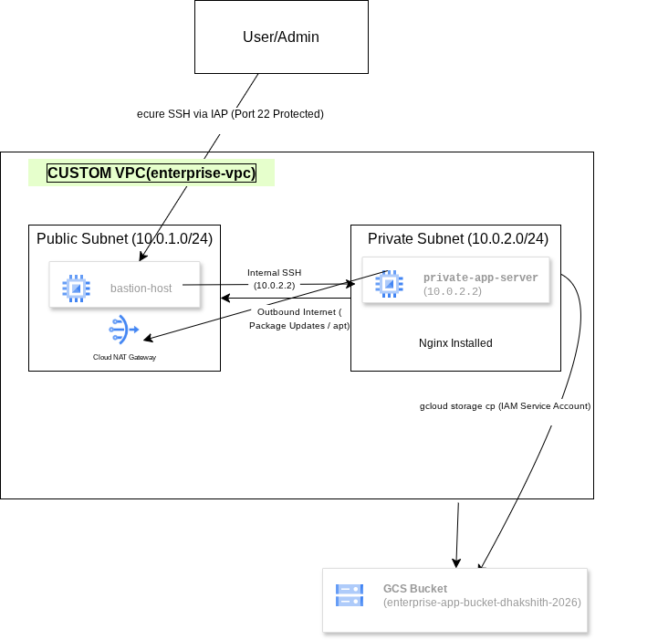

# 🚀 Secure Multi-Tier Enterprise Cloud Architecture on GCP

# 📌 Project Overview
A production-grade, highly secure 3-tier cloud architecture deployed on Google Cloud Platform (GCP). Designed with strict network isolation, zero external exposure for backend workloads, secure administrative access via Identity-Aware Proxy (IAP), and keyless service account integrations.

---

# 🏗️ Architecture Diagram

- **Public Subnet (`10.0.1.0/24`):** Hosts the Bastion Host (accessed securely via IAP) and Cloud NAT Gateway.
- **Private Subnet (`10.0.2.0/24`):** Hosts the Backend App Server with **no external IP address**, relying entirely on Cloud NAT for secure outbound internet access.
- **Storage Tier:** Google Cloud Storage (GCS) bucket secured via uniform bucket-level access and least-privilege IAM service account roles.

---

# 🛠️ Key Implementation Steps & Technical Highlights
1. **Custom VPC Isolation:** Built a segmented network separating public-facing entry points from isolated backend resources.
2. **Secure Bastion & IAP:** Bypassed exposing SSH port (`22`) to the public internet by routing administrative access through Google Cloud Identity-Aware Proxy (IAP).
3. **Cloud NAT Egress Routing:** Enabled outbound internet routing for private instances to fetch package updates (`nginx`) without inbound vulnerability.
4. **Keyless Machine-to-Machine IAM:** Configured Compute Engine default service accounts with `Storage Object Admin` roles, ensuring secure cloud storage uploads without hardcoded credentials.

---

## 📸 Execution Proofs

### File Upload to GCS from Private VM
\`\`\`bash
$ gcloud storage cp test.txt gs://enterprise-app-bucket-dhakshith-2026/
Copying file://test.txt to gs://enterprise-app-bucket-dhakshith-2026/test.txt
Operation completed.
\`\`\`
