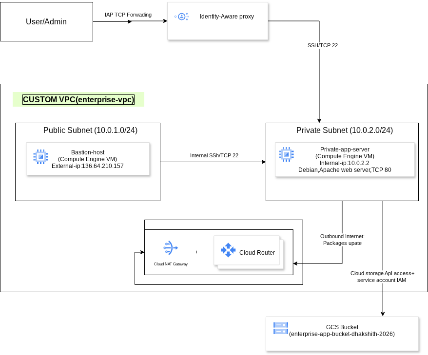

# Secure Multi-Tier Enterprise Cloud Architecture on GCP

A hands-on Google Cloud Platform (GCP) project focused on designing and configuring a secure cloud network with private compute resources, controlled administrative access, IAM permissions, Cloud Storage, and web-server deployment.

## Project Overview

This project demonstrates the implementation of a multi-tier cloud infrastructure on Google Cloud Platform. It uses a custom Virtual Private Cloud (VPC), separate subnets for the bastion host and private application server, firewall rules, Cloud NAT, Identity and Access Management (IAM), and Cloud Storage.

A web page is hosted on an Apache web server running on a private Compute Engine virtual machine. The application VM has no external IP address and can be accessed through the configured administrative access path. The VM's service account is also used to access a private Cloud Storage bucket.

The objective is to gain practical experience with cloud networking, compute infrastructure, access control, and basic cloud security.

## Architecture



### Architecture Components

| Component | Purpose |
|---|---|
| Google Cloud VPC | Provides an isolated cloud network for project resources. |
| Bastion host | Provides an administrative access path to the private application VM. |
| Subnets | Separate the bastion host and private application server into different network segments. |
| Firewall rules | Control permitted network traffic to and within the VPC. |
| Cloud Router and Cloud NAT | Provide outbound internet connectivity for eligible private VM traffic without requiring an external IP on the VM. |
| Compute Engine | Hosts the private application server. |
| Apache HTTP Server | Serves the project's demonstration webpage. |
| IAM service account | Provides an identity for authenticated access to Google Cloud resources. |
| Cloud Storage | Stores a test object in a non-public regional bucket. |

## Technologies and Services

- Google Cloud Platform (GCP)
- Virtual Private Cloud (VPC)
- VPC subnets and firewall rules
- Compute Engine
- Bastion-host access
- Cloud Router and Cloud NAT
- Identity and Access Management (IAM)
- Cloud Storage
- Debian Linux
- Apache HTTP Server
- Linux shell and Google Cloud CLI (`gcloud`)

## Implementation Details

### 1. VPC and Network Segmentation

Created a custom VPC with separate subnets for administrative access and the private application server.

| Resource | Configuration |
|---|---|
| Bastion subnet | `10.0.1.0/24` |
| Private application subnet | `10.0.2.0/24` |
| Private application VM internal IP | `10.0.2.2` |

The separate subnets provide a foundation for isolating administrative and application resources.

### 2. Private Compute Engine VM

Created a Compute Engine virtual machine named `private-app-server` with Debian Linux.

| Setting | Value |
|---|---|
| VM name | `private-app-server` |
| Zone | `us-central1-b` |
| Operating system | Debian |
| Internal IP | `10.0.2.2` |
| External IP | None |
| Web server | Apache HTTP Server |

The VM was accessed through the configured bastion-host administrative path.

### 3. Web Server Deployment

Deployed a demonstration webpage on the private VM using Apache HTTP Server.

The page displays the project title, a successful deployment message, the compute platform, and the web-server details.

Verified that the web server responds successfully from within the VM.

```bash
curl -I http://localhost
```

Expected result: an HTTP success response, such as `HTTP/1.1 200 OK`.

To inspect the listening service:

```bash
sudo ss -ltnp | grep ':80'
```

These checks confirm that the web server is running and listening on port 80.

### 4. Bastion-Host Access

Connected to the private application VM through the configured bastion-host access path.

This demonstrates an administrative access pattern in which the application VM does not need a public IP address to be managed.

The actual access path and the applicable firewall rules are documented in the architecture diagram and supporting screenshots.

### 5. Cloud NAT and Outbound Connectivity

Configured Cloud NAT with Cloud Router to support outbound connectivity for eligible resources in the private network.

Cloud NAT allows supported outbound connections without requiring the private application VM to have an external IP address. It does not, by itself, provide unsolicited inbound connectivity to the VM.

### 6. Cloud Storage Integration

Created a regional, non-public Cloud Storage bucket:

`enterprise-app-bucket-dhakshith-2026`

Uploaded a test object named `test.txt` and verified access from the private application VM using the Google Cloud CLI.

List objects in the bucket:

```bash
gcloud storage ls gs://enterprise-app-bucket-dhakshith-2026/
```

Read the contents of the test object:

```bash
gcloud storage cat gs://enterprise-app-bucket-dhakshith-2026/test.txt
```

Expected test output:

```text
GCP Cloud Storage verification
```

Both commands completed successfully using the active Compute Engine default service account.

### 7. IAM and Access Control

Verified the Compute Engine default service account used by the VM:

`624900597663-compute@developer.gserviceaccount.com`

The service account has the `Storage Object Admin` role on the bucket. This role permits object-level operations, including listing, reading, creating, and deleting objects.

The bucket has Public Access Prevention enabled and is not publicly accessible.

**Security consideration:** `Storage Object Admin` is broader than required for a read-only application. A production deployment should use least-privilege permissions appropriate to the application's actual requirements.

## Execution Evidence

The following screenshots document the deployed infrastructure and verification steps.

| Screenshot | Evidence |
|---|---|
| `execution screenshots/deployed-webpage.png` | Demonstration webpage served by Apache. |
| `execution screenshots/VM_Configuration.png` | Compute Engine VM details, including the absence of an external IP. |
| `execution screenshots/vpc-subnets.png` | VPC and subnet configuration. |
| `execution screenshots/bastion-private-vm-connection.png` | Successful administrative connection to the private VM. |
| `execution screenshots/cloud-storage-object.png` | Test object stored in the Cloud Storage bucket. |
| `execution screenshots/cloud-storage-read-test.png` | Successful command output showing the contents of `test.txt`. |
| `execution screenshots/cloud-storage-iam.png` | Service account and its bucket-level IAM role. |
| `execution screenshots/bucket-security.png` | Regional bucket configuration and Public Access Prevention status. |
| `execution screenshots/firewall-rules.png` | Configured VPC firewall rules. |

### Web Application


### Private VM Configuration


### VPC and Subnets


### Private VM Administrative Access


### Cloud Storage Verification


### IAM Permissions


### Bucket Security


### Firewall Rules


## Security Considerations

- The application VM has no external IP address.
- Administrative access is provided through the configured access path.
- VPC firewall rules govern permitted network traffic.
- Cloud Storage Public Access Prevention is enabled.
- The VM uses a service account to authenticate Google Cloud CLI operations.
- IAM permissions should follow the principle of least privilege.
- Firewall rules should allow only the required source ranges, protocols, ports, and targets.

This is a learning project and should not be considered production-hardened without additional security review, monitoring, and operational controls.

## Key Learning Outcomes

Through this project, I gained hands-on experience with:

- Creating and organizing a custom VPC and subnets.
- Deploying a private Compute Engine virtual machine.
- Accessing private infrastructure through a bastion-host access path.
- Deploying and validating an Apache web server on Debian Linux.
- Configuring Cloud Router and Cloud NAT for outbound connectivity.
- Using service accounts and IAM permissions for Cloud Storage access.
- Verifying bucket privacy and Public Access Prevention.
- Troubleshooting cloud permissions and validating infrastructure through command-line tests.
- Documenting cloud architecture and implementation evidence in GitHub.

